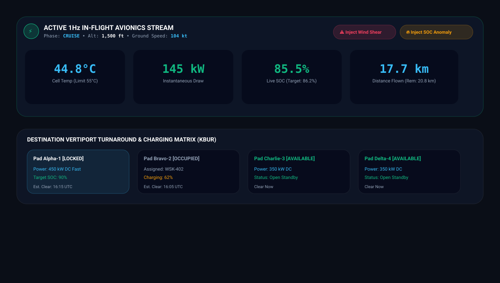
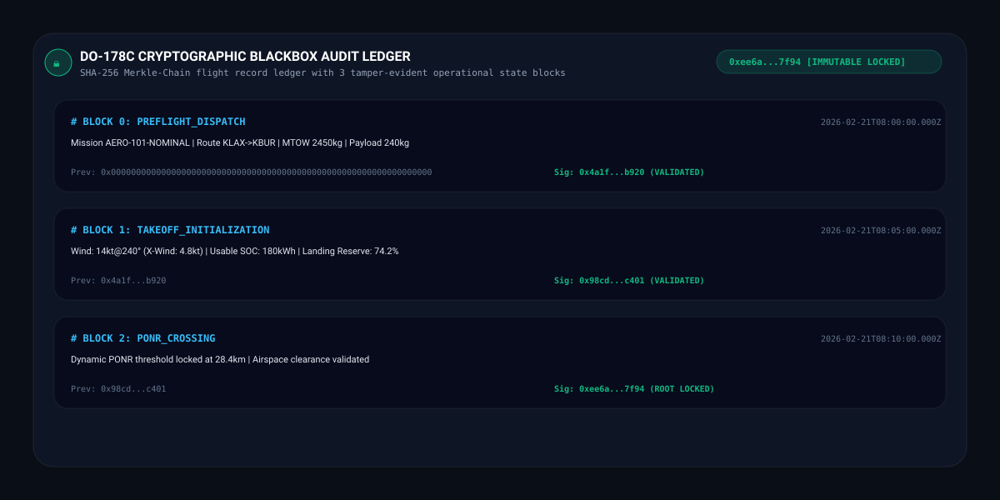
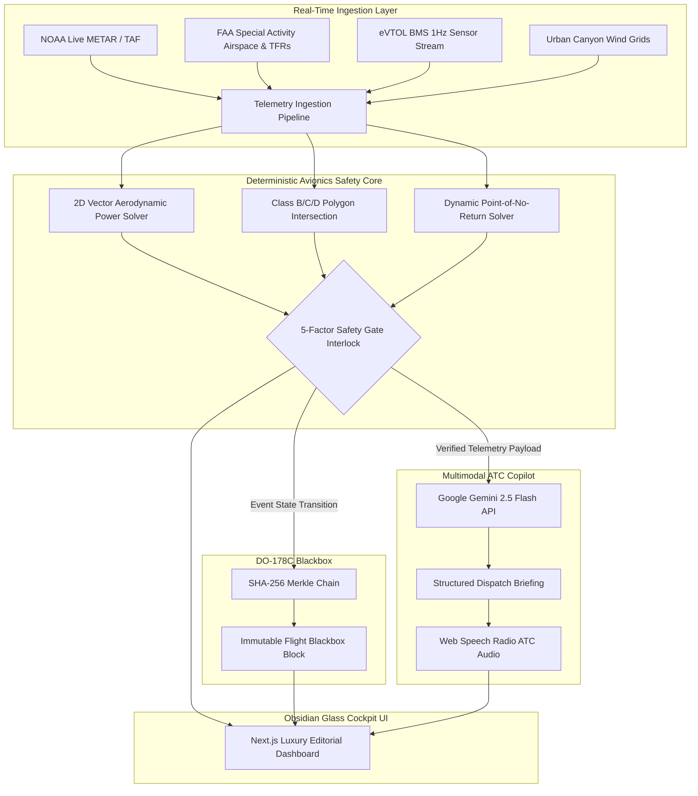

<div align="center">

# ✈️ AeroOps AI v2.0
### Autonomous Flight Readiness & In-Flight Fleet Risk Intelligence Platform
**Engineered for Advanced Air Mobility (eVTOL) & BVLOS Drone Fleet Operations**

[](https://github.com/fokrulanthro16-eng/aeroops-ai/actions)
[](https://nextjs.org/)
[](https://www.typescriptlang.org/)
[](https://tailwindcss.com/)
[](https://ai.google.dev/)
[](https://en.wikipedia.org/wiki/DO-178C)
[](https://github.com)
[](https://github.com)

*From raw aviation telemetry to explainable, evidence-backed GO / AMBER / NO-GO mission releases and dynamic in-air deconfliction.*

</div>

---

## 📸 Cockpit Showcase & Operational Visuals

### 1. Pre-Flight Readiness Cockpit & 60/40 Vector Radar Split View
*High-resolution glassmorphic operations console displaying 5-factor safety gates, vector corridors, and dynamic Point of No Return (PONR) calculation.*

<div align="center">
  
</div>

---

### 2. Active 1Hz In-Flight Telemetry HUD & Destination Turnaround Matrix
*Real-time 1Hz avionics streaming, live battery thermal modeling, anomaly injectors (Wind Shear / Battery Decay), and automated Burbank alternate vertiport diversion.*

<div align="center">
  
</div>

---

### 3. DO-178C Cryptographic Blackbox Audit Ledger
*SHA-256 Merkle-Chain flight record ledger generating tamper-evident operational blocks for regulatory authorities and insurance underwriters.*

<div align="center">
  
</div>

---

## 🧭 Core Philosophy: *"Rules Engine Decides, AI Explains"*

In safety-critical aviation (**DO-178C / FAA Part 135 / EASA SC-VTOL**), probabilistic GenAI models must **never** be single points of failure for flight-critical go/no-go clearances. 

AeroOps AI enforces a strict, robust architectural boundary:
1. **Deterministic Physics & Risk Engine:** Evaluates all hard regulatory safety gates, aerodynamic power draws, thermal battery derates, crosswinds, and dynamic turnback points (Point of No Return - PONR).
2. **Explainable Multimodal AI Layer (Google Gemini 2.5 Flash):** Ingests verified ground-truth telemetry and evidence records to synthesize human-readable executive briefings and synthesized radio ATC voice dispatch.

---

## 🏛️ System Architecture



---

## âš¡ Key Capabilities & Technical Highlights

### 1. Dual-Mode Operational Cockpit
- **Pre-Flight Readiness Dispatch:** 5-factor risk scoring with instant safety interlock checklists and tactile What-If aerodynamic performance sliders.
- **Active In-Flight HUD (1Hz):** Live telemetry streaming for battery cell temperatures, instantaneous power discharge (kW), live SOC degradation, and dynamic turnaround distance timeline.

### 2. Autonomous In-Flight Dynamic Diversion
- Sub-millisecond vector recalculation upon in-flight corridor anomalies (Wind Shear > 28 kt, Bird Strikes, Battery SOC depletion > 5%).
- Automatic alternate vertiport selection (**KBUR / Burbank Vertiport**) with dedicated MegaWatt fast-charging pad reservations.

### 3. Urban Canyon Micro-Weather Modeler
- Localized building-canyon Venturi effect turbulence scaling:
$$\text{AmplifiedWind} = \text{BaseWind} \times (1 + \text{CanyonNarrowingFactor} \times \text{BuildingHeightRatio})$$

### 4. Smart Vertiport Turnaround & Fast-Charge Matrix
- Multi-bay charging turnaround status grid (Pads 1..4: `AVAILABLE`, `RESERVED`, `OCCUPIED`) with auto-reservation badges and clear timers in UTC.

### 5. Cryptographic Blackbox Audit Ledger (DO-178C)
- Every state change produces a cumulative block hash:
$$\text{Hash}_n = \text{SHA256}(\text{Hash}_{n-1} + \text{Timestamp} + \text{TelemetryPayload} + \text{RiskVerdict})$$
- Ensures complete source-to-decision auditability for aviation authorities and insurance underwriters.

---

## 🧪 Rigorous Verification & Test Matrix

- ✔ **Unit & Physics Tests:** `39 / 39 PASSED` (0 failures)
- ✔ **End-to-End Integration:** `16 / 16 PASSED` (0 errors)
- ✔ **TypeScript Static Check:** `0 errors / 100% Type-Safe`
- ✔ **Production Compilation:** `Next.js 14 (HTTP 200 OK)`

---

## 🚀 Quickstart & Local Setup

```bash
# 1. Clone the repository
git clone https://github.com/fokrulanthro16-eng/aeroops-ai.git
cd aeroops-ai

# 2. Install dependencies
npm install

# 3. Configure Environment
cp .env.example .env.local
# Add your GEMINI_API_KEY to .env.local

# 4. Run Automated Test Suite
npm run test

# 5. Launch Cockpit Development Server
npm run dev
```

Open [http://localhost:3000](http://localhost:3000) with your browser.

---

## 📜 License

Distributed under the MIT License. See `LICENSE` for more information.